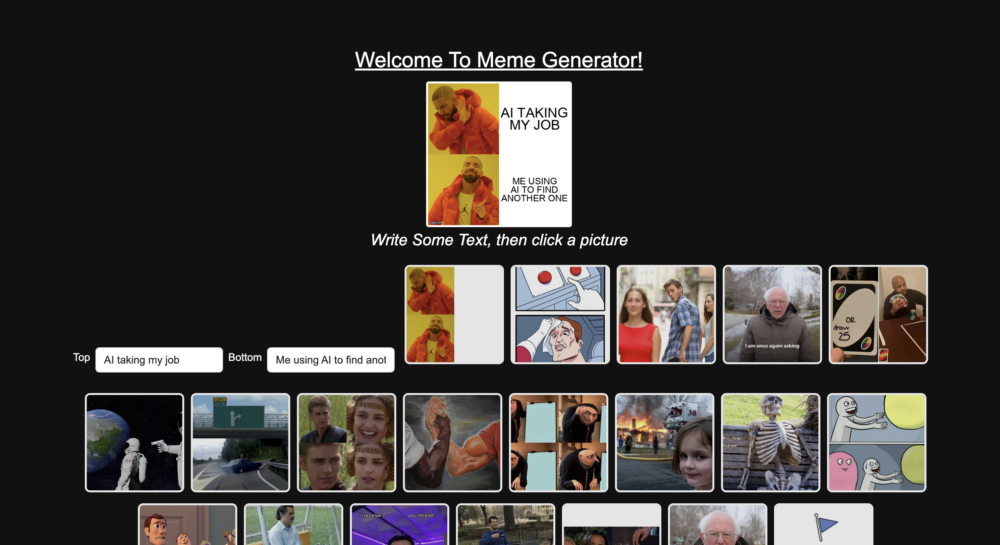
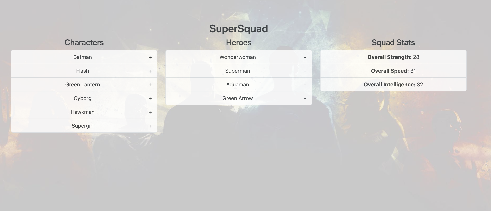
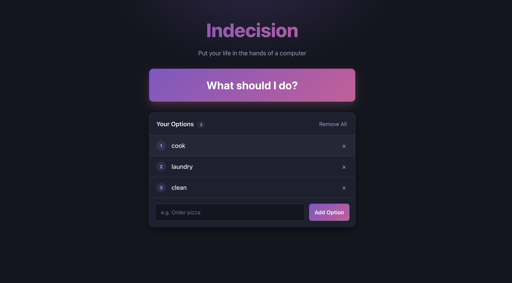
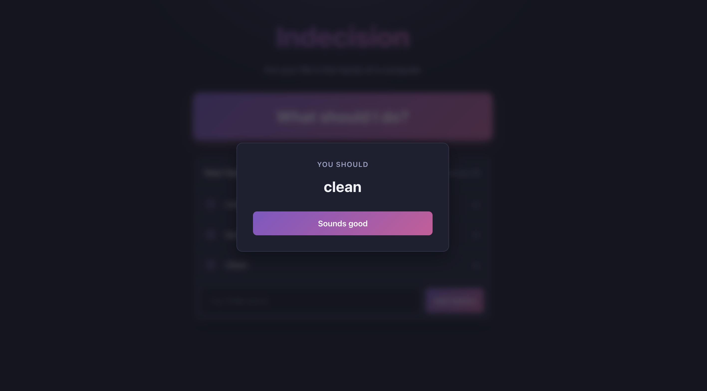
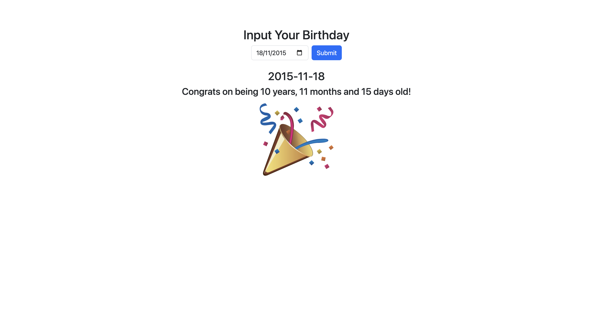

# React Applications

Four small front-end apps built with React. Each one is self-contained and focuses on a different core skill: component state and hooks, Redux state management, working with REST APIs, and styling with Sass.

I first built these in 2019 while learning React. In 2026 I brought them up to date: they now run on React 19 and Vite, and I fixed bugs along the way.

**Tech:** React 19 · Redux · Vite · JavaScript (ES2020+) · Bootstrap 5 · Sass · REST APIs

---

## Meme Generator

Type a caption, click a meme template, and the app returns your finished meme from the imgflip API.



- Uses Redux with redux-thunk to fetch data and to send requests to a third-party API
- Handles API errors and shows them to the user instead of failing silently
- Keeps API credentials out of the source code by loading them from environment variables

[View code](generator)

## SuperSquad

Pick superheroes for your squad, and the squad's total strength, speed and intelligence update as you go.



- Uses Redux, with separate reducers for the character list and the chosen squad
- Calculates the stats from the current state instead of storing a second copy

[View code](supersquad)

## Indecision App

Add the options you can't decide between, and the app picks one for you.

<p>
  
  
</p>

- Saves your options in the browser so they're still there after a page refresh
- Styled with Sass, organized into one file per component
- Uses an accessible popup (react-modal) to show the result

[View code](indecision-app)

## Age Teller

Enter your birthday and get your exact age in years, months and days.



- Built with React function components and hooks
- Calculates age from real calendar dates, so leap years and months of different lengths are handled correctly

[View code](ageteller)

---

## Running an app locally

Each app runs on its own. You'll need Node.js 20.19+ or 22.12+.

```bash
git clone https://github.com/suhanaayisha/react-applications.git
cd react-applications/indecision-app   # or any other app folder
npm install
npm run dev                             # opens at http://localhost:5173
```

The Meme Generator needs a free imgflip account to caption memes. See [its README](generator/README.md) for setup.

## Contact

Suhana Ayisha · [GitHub](https://github.com/suhanaayisha)
